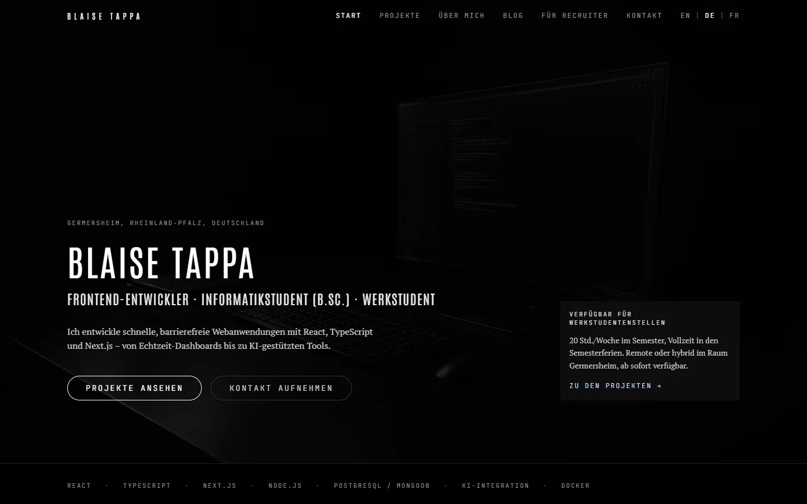

# Blaise Tappa — Portfolio

[](https://github.com/BlaiseTAPPA/portfolio_bt/actions/workflows/ci.yml)
[](LICENSE)

My portfolio as a frontend developer and computer science student: case studies, CV and blog in German, English and French, built on one typed content model.

**Live:** [portfolio-bt-iota.vercel.app](https://portfolio-bt-iota.vercel.app)



## Stack

| Area      | Tools                                                                             |
| --------- | --------------------------------------------------------------------------------- |
| Framework | Next.js 16.4 (App Router, static generation), React 19.3                          |
| i18n      | next-intl 4: `/de`, `/en`, `/fr` routes, Accept-Language detection, hreflang      |
| UI        | Tailwind CSS 4.3, Framer Motion 13 (one client island), `next/font`, `next/image` |
| Language  | TypeScript 5.9 (strict, see below)                                                |
| PDF CV    | jsPDF 4, generated in the browser from the content model                          |
| Quality   | ESLint 9 (`eslint-config-next`), Prettier 3, GitHub Actions                       |
| Hosting   | Vercel                                                                            |

## Architecture decisions

**Every page is prerendered, per locale.** All routes are Server Components and are generated at build time for German, English and French (`generateStaticParams` for locales, projects and blog posts). Crawlers and link previews (LinkedIn, Slack, WhatsApp) get complete HTML with the right title, description and image, with no user-agent sniffing. Only the parts that need the browser are client components: header menu and language switch, footer clock, contact form, CV download/print buttons and the project grid animation.

**Localized URLs.** Each page exists at `/de/…`, `/en/…` and `/fr/…`; German is the default. [`src/proxy.ts`](src/proxy.ts) sends `/` to the visitor's language (cookie, then `Accept-Language`) and permanently redirects the old unprefixed URLs (`/cv` → `/de/cv`, 308), so links in older CVs and on LinkedIn keep working. The language switch links to the same page in the other language, and `<html lang>` is rendered on the server.

**SEO from the Metadata API.** [`src/lib/seo.ts`](src/lib/seo.ts) builds each page's title, description, canonical URL, hreflang alternates (+ `x-default`), Open Graph and Twitter tags. The home page carries `Person` JSON-LD, projects `SoftwareApplication` and posts `BlogPosting`. [`sitemap.ts`](src/app/sitemap.ts) lists every page in every locale with its alternates.

**One typed, localized content model.** Every fact on the site (profile, projects, experience, education, blog posts) lives in [`src/lib/content.ts`](src/lib/content.ts). Translatable fields are typed as `Record<Lang, string>`, so adding a locale makes the compiler point at every missing translation. Pages render this data and hold no facts of their own, and the PDF CV is built from the same source, so site and CV can't drift apart.

**UI strings are split from content.** Interface copy lives in [`messages/{de,en,fr}.json`](messages), typed against the German file, so a wrong key fails the typecheck. `npm run check:i18n` fails on empty strings, missing keys, mismatched placeholders or informal "du" forms in the German copy.

**Strict TypeScript.** Beyond `strict`, the project enables `noUncheckedIndexedAccess`, `exactOptionalPropertyTypes`, `noPropertyAccessFromIndexSignature`, `noImplicitReturns`, `noUnusedLocals` and `noUnusedParameters`. Route props use Next's generated `PageProps<"/[locale]/…">` types.

**Fast on mobile.** Fonts are self-hosted at build time by `next/font` (no request to Google, `display: swap`). The hero image is preloaded and served as AVIF/WebP at the screen's width. Framer Motion loads through `LazyMotion` on the projects page only, and jsPDF (~400 kB) loads only when someone clicks "download CV" ([`src/lib/cv-download.ts`](src/lib/cv-download.ts)).

## Scripts

| Command                | What it does                                  |
| ---------------------- | --------------------------------------------- |
| `npm run dev`          | Dev server on http://localhost:3000           |
| `npm run build`        | Production build (static pages into `.next/`) |
| `npm run start`        | Serve the production build                    |
| `npm run typecheck`    | Generate route types, then `tsc`              |
| `npm run lint`         | ESLint (Next.js rules, incl. Prettier)        |
| `npm run format`       | Format everything with Prettier               |
| `npm run format:check` | Check formatting without writing              |
| `npm run check:i18n`   | Check translations for gaps and "du" forms    |

CI runs `typecheck`, `lint`, `format:check`, `check:i18n` and the build on every push and pull request.

Requirements: Node.js 22 or newer, npm.

```bash
npm ci
npm run dev
```

## Project structure

```text
├── .github/workflows/ci.yml     CI: typecheck, lint, format, i18n, build
├── messages/{de,en,fr}.json     UI strings per locale
├── public/                      Images, OG image, favicon
├── scripts/check-i18n.ts        Translation check
├── src/
│   ├── app/
│   │   ├── [locale]/            One folder per route (layout, pages, localized 404)
│   │   ├── sitemap.ts           sitemap.xml with hreflang alternates
│   │   └── robots.ts            robots.txt
│   ├── components/              Header, footer, client islands, contact form
│   ├── i18n/                    next-intl routing, navigation and request config
│   ├── lib/
│   │   ├── content.ts           Typed, localized content model (single source of truth)
│   │   ├── seo.ts               Metadata, hreflang and JSON-LD builders
│   │   └── cv-pdf.ts            PDF CV built from content.ts
│   ├── proxy.ts                 Locale detection and redirects of old URLs
│   └── styles.css               Tailwind 4 theme and base styles
└── next.config.ts
```

## About me

Built by **Blaise Tappa**, B.Sc. Computer Science student at SRH University (Campus Heidelberg), based in Germersheim. **Open to Werkstudent roles in frontend development.**

- Email: [melvynngaba@gmail.com](mailto:melvynngaba@gmail.com)
- LinkedIn: [linkedin.com/in/blaise-tappa](https://linkedin.com/in/blaise-tappa)
- GitHub: [@BlaiseTAPPA](https://github.com/BlaiseTAPPA)

## License

[MIT](LICENSE)
